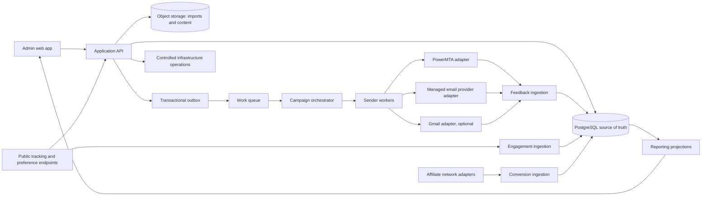

# AlphaLink — advanced reference system

**Version:** 2026-10-22 · **Purpose:** build specification derived from the read-only DMS inspection. This describes the system AlphaLink should implement, not a claim that DMS already behaves this way. AlphaLink now has an initial Laravel API and PostgreSQL-oriented foundation under `apps/api`; there is no frontend, deployed environment, database migration, or sending path yet. The code is a provisional first slice, not production readiness.

## 1. Evidence and design rule

The DMS [complete conclusion](DMS_COMPLETE_CONCLUSION_2026-10-22.md) establishes its modules and data flows. The [REA sender resolution](DMS_REA_SENDER_RESOLUTION_2026-10-22.md) establishes the configured worker's modes, campaign detail fetch, intended PMTA listener, SMTP command construction, and durable progress/status SQL. Those are static observations. Actual final MIME bytes, per-recipient acceptance and delivery, reliable retry/checkpoint behavior, production configuration, and complaint suppression were not verified. AlphaLink must specify those behaviors explicitly instead of copying assumptions.

**Product aim:** one tenant-aware SaaS for permissioned audience management, campaign composition, controlled email submission, reliable delivery feedback, engagement, affiliate attribution, infrastructure management, and auditable reporting. Its defining distinction is a traceable recipient lifecycle from permission to submission to feedback, with transport flexibility and safe recovery.

## 2. System architecture

The application owns business state. Workers own attempts and provider calls. Feedback ingestion owns provider events. Reporting reads projections built from immutable events; it does not infer delivery from a worker progress number.

### Recommended technology baseline

| Layer | Recommended baseline | Reason and limit |
|---|---|---|
| Admin application and API | Laravel/PHP, with a TypeScript frontend if interactive administration warrants it | Keeps the familiar DMS domain while allowing a clearer API contract. A frontend framework is a product choice, not a requirement for reliability. |
| Transactional store | PostgreSQL | Strong constraints and transactions; tenant isolation can also use row-level security where appropriate. RLS needs carefully scoped DB roles and is not a substitute for application authorization. [PostgreSQL documentation](https://www.postgresql.org/docs/current/ddl-rowsecurity.html). |
| Short work and scheduling | Redis-backed queue with PostgreSQL outbox and durable job records | Redis can move work; PostgreSQL records the committed intent and recovery state. A queue delivery alone is not exactly-once execution. |
| High-volume sender | .NET managed worker or another team-supported compiled runtime, behind a versioned job protocol | .NET is already viable in the reference. The improvement is supervision, typed inputs, cancellation and durable per-recipient results, not a language change. [Microsoft hosted-service guidance](https://learn.microsoft.com/en-us/aspnet/core/fundamentals/host/hosted-services). |
| Files | Private object storage with checksums, versioned manifests and expiry | Imported files, creative assets, recipient snapshots and provider feedback need reproducible identity without becoming the only state store. |
| Mail transport | PowerMTA adapter plus optional managed-provider adapter; Gmail isolated as a separate adapter | Lets tenants choose infrastructure while giving AlphaLink one submission/result contract. A service such as SES publishes send, delivery, bounce and complaint events, but its use depends on account, region, policy and cost. [AWS event documentation](https://docs.aws.amazon.com/ses/latest/dg/monitor-sending-activity-using-notifications.html). |
| Observability | Structured logs, metrics and traces correlated by tenant, campaign, send, recipient attempt and provider message ID | Supports diagnosis and audit without placing secrets or full message bodies in logs. |

Do not decide infrastructure size, cloud provider, UI framework, or managed email provider solely from the DMS inspection. Those require expected volume, tenant count, hosting jurisdiction, budget and operational ownership.

## 3. Product modules

### A. Tenants, users and access

- Tenant, workspace, user, role and service identity are first-class records. Every campaign, list, asset, provider account, infrastructure resource and event has a tenant scope.
- Roles cover owner, administrator, campaign operator, analyst, infrastructure operator and read-only auditor; permissions are actions, not menu visibility.
- Sensitive actions (provider credentials, domains, SMTP settings, sends, exports, server commands) have explicit authorization and audit entries. Service identities use narrow scopes.
- Tenant data separation is enforced in queries and checked at the database boundary where practical. Public tracking identifiers must not reveal tenant internals.

### B. Audience, lists and consent

- A contact has one canonical identity per tenant, with separate list memberships. This avoids DMS's one-list-per-email constraint while preserving each list's provenance.
- Store consent basis, source, timestamp, policy/version and evidence reference. Track global opt-out, list unsubscribe, offer suppression, complaint, hard bounce and tenant block separately.
- Imports validate syntax, normalize cautiously, retain source-file checksum, count rejected/duplicate rows, and provide a dry preview before commit.
- Segments are saved query definitions with a version. A campaign freezes a membership snapshot with counts, rule version and source checksums; the sender rechecks current hard blocks and opt-outs immediately before an attempt.
- Suppression decisions return a reason and timestamp. No virtual mix or imported file bypasses the final suppression check.

### C. Offer, asset and affiliate catalogue

- Sponsor/network accounts, external offer IDs, payout/currency, state, GEO constraints, redirect/unsubscribe URLs, creatives and suppression sources are normalized and tenant scoped.
- Manual import, provider discovery, periodic refresh and conversion import are distinct jobs with separate results. A refresh cannot silently create or delete offers unless configured.
- Adapters for HitPath, NewHitPath, Cake, HasOffers and EverFlow can be phased in from the DMS map. Each adapter declares auth method, pagination, rate limits, retry rules, mapping version and supported operations.
- Conversion events preserve provider event ID, original payload digest, attribution token, amount/currency, reversal/correction status and ingestion time. Database uniqueness prevents duplicate credit.

### D. Content and message composition

- Versioned templates hold subject, from/reply-to, return-path policy, text and HTML bodies, assets, placeholders, link policy and optional attachments.
- Compilation produces a deterministic recipient-specific message artifact and validation result before transport. Preview and test use the same compiler as production.
- Validate header safety, MIME structure, placeholder completeness, link destinations, unsubscribe requirements and provider limits. Store a body hash and compiler version, not every rendered body indefinitely.
- Domain identity includes verified ownership and explicit SPF, DKIM and DMARC state. Signing responsibility is defined per transport adapter.

### E. Campaigns, drops, warmups and tests

- One job model supports campaign, drop, warmup and test as typed variants. Shared lifecycle, auditing and feedback contracts avoid inconsistent state handling.
- Configuration includes audience snapshot, offer, content version, sender identities, transport account, schedule, rate policy, per-domain/ISP limits, seed policy, stop conditions and safety limits.
- Draft, validated, scheduled, queued, running, pausing, paused, cancelling, cancelled, completed, completed-with-errors and failed are explicit states. Every transition records actor, reason and time.
- A preflight checks tenant permissions, consent/suppression, domain readiness, provider status, audience size, content, schedule and budget/volume caps. Production launch requires a distinct action from preview/test.
- Resume uses durable cursor and per-recipient attempt state. Pause stops new attempts; cancel also records unfinished work. There is no force-kill based solely on an unverified PID.

### F. Sender and transport

- Workers receive an immutable, versioned job envelope identifying the tenant, campaign run, snapshot and content versions, rate policy and adapter. They fetch secrets through a scoped secret service, never from a user-visible config file.
- Partition work by tenant and transport capacity. Rate limiting can apply globally, per tenant, per server, per domain and per provider. Backpressure protects both mail systems and the database.
- For each recipient, persist an attempt ID **before** external submission. Record request hash, provider response, provider message ID, retry count, timestamps and terminal reason. Use idempotency keys where providers support them; otherwise reconcile uncertain outcomes before retrying.
- Transport outcomes distinguish `prepared`, `attempted`, `submitted`, `accepted`, `deferred`, `rejected` and `unknown`. `delivered`, `bounced` and `complained` come from later feedback. Accepted is not delivered.
- SMTP adapters read and classify replies at each required stage, handle timeouts/TLS/auth failures, and never count a write to a socket as acceptance. PowerMTA-specific `x-envid`, job and VMTA metadata map to stable AlphaLink IDs. Managed providers map their own message/event IDs to the same attempt.
- A worker heartbeat and lease allow recovery after crashes. Retrying an `unknown` outcome must first check available provider/PMTA evidence to avoid accidental duplicates.

### G. Feedback, tracking and preferences

- PMTA file ingestion and managed-provider webhooks enter a common feedback pipeline. Inputs are authenticated or acquired from trusted storage, schema checked, checksum recorded and deduplicated by provider event identity.
- Preserve raw event provenance separately from normalized `delivery`, `bounce`, `defer`, `complaint` and other states. Unknown/unmatched feedback enters a reconciliation queue rather than being discarded.
- Open pixels and click redirects use signed, expiring, opaque tokens and minimal public data. Tracking records bot/proxy confidence; an open is not proof of a human read.
- A preference center supports global opt-out, list-level unsubscribe and offer-specific exclusion. All suppression changes take effect before the next submission attempt and are auditable.
- Complaints and hard bounces create durable suppressions. Reply mailboxes and feedback-loop reports need explicit parsing and recipient identity rules; a generic reply audience is not complaint handling.

### H. Reporting and attribution

- Immutable event records are the source of truth. Projections expose audience count, attempted, accepted, delivered, bounced, complained, opened, clicked, unsubscribed, converted and revenue, each with a documented denominator and time basis.
- Each event carries tenant, run, message/attempt, recipient, provider and relevant offer dimensions. Late feedback and reversals rebuild affected aggregates without silently double counting.
- Affiliate attribution uses signed identifiers with a defined window and last/first-touch rule. Reversed provider conversions reduce revenue through corrective events.
- Dashboards state data freshness, unmatched feedback count and provider gaps. Exports respect tenant permissions and retention rules.

### I. Domains, servers and provider operations

The first PMTA server-install workflow, its mandatory/optional components, package availability gates and OS decision are specified in [SERVER_INSTALLATION_V1.md](../design/SERVER_INSTALLATION_V1.md).

- Domain/registrar, DNS, IP, server, VMTA and provider account inventories are separate from campaign data. Each resource has owner, environment, status, credential reference and change history.
- Provisioning plans are previewed, approved, applied, health checked and reversible where possible. Destructive installation or PMTA reset is never hidden behind a page view or GET action.
- Server access verifies host identity, uses least-privilege accounts and stores secrets in a managed vault. Infrastructure commands use authenticated transport, constrained allowlists and auditable job IDs.
- Provider adapters may support GoDaddy/Namecheap and the cloud providers found in DMS, but first release scope depends on actual AlphaLink operations. Inactive adapters should not enlarge the security surface.

## 4. Core data contract

At minimum, define these durable entities (names are conceptual, not final table names):

| Group | Core records and key constraints |
|---|---|
| Identity | `Tenant`, `User`, `Membership`, `RoleGrant`, `ServiceIdentity`, `AuditEvent`; every owned row has tenant ID. |
| Audience | `Contact` unique per tenant/address, `List`, `ListMembership`, `ConsentEvidence`, `Suppression`, `SegmentDefinition`, `AudienceSnapshot`, `SnapshotMember`. |
| Marketing | `Sponsor`, `Offer` unique per tenant/provider/external ID, `CreativeAsset`, `TemplateVersion`, `Campaign`, `CampaignRun`, `SendPolicy`. |
| Delivery | `RecipientMessage` unique per run/snapshot member, `SendAttempt` unique attempt ID, `ProviderMessageMap`, `TransportEvent` unique provider event key, `FeedbackImport`. |
| Engagement | `TrackingToken`, `EngagementEvent` with replay key, `PreferenceEvent`, `ConversionEvent` unique provider conversion ID, `RevenueAdjustment`. |
| Infrastructure | `Domain`, `DNSRecordPlan`, `Server`, `IPAddress`, `VMTA`, `ProviderAccount`, `SecretReference`, `InfrastructureJob`. |
| Operations | `OutboxEvent`, `JobLease`, `ImportJob`, `ProjectionCheckpoint`, `Alert`. |

IDs crossing provider, worker and tracking boundaries are opaque and stable. Foreign keys and uniqueness carry critical invariants; JSON fields hold extensible provider metadata, not the sole relationship graph. Avoid storing production credentials, raw recipient lists, or full rendered messages in analytics tables.

## 5. Canonical end-to-end flow

1. **Prepare:** import contacts with provenance; record consent and suppressions; define a segment and freeze a versioned snapshot.
2. **Compose:** create a versioned template and offer association; compile previews and run checks against actual transport limits.
3. **Authorize:** preflight validates access, audience, domains, content, provider readiness and volume. An operator schedules or explicitly launches a run.
4. **Enqueue:** one transaction records the run and outbox intent. The orchestrator creates recipient work with stable IDs and bounded partitions.
5. **Submit:** worker rechecks current suppressions, acquires capacity, records an attempt, renders content, submits through an adapter, and persists the exact observed submission outcome.
6. **Reconcile:** feedback ingestion maps provider/PMTA events to attempt IDs, suppresses complaints/hard bounces and flags unmatched or contradictory events.
7. **Engage:** signed links/pixels record events and preferences; affiliate adapters import and reconcile conversions and reversals.
8. **Report:** projections calculate metrics from immutable events, show freshness and allow trace from a report count to its source event.
9. **Recover:** crashed workers release leases; the orchestrator retries only safe work, investigates uncertain submissions and records the reason for every skipped or repeated attempt.

## 6. Non-negotiable operating rules

- All production sends require permissioned recipients and a working unsubscribe route. Consent and complaint policy must match the jurisdictions and providers actually used.
- No public route changes state through GET except intended tracking/preference actions whose semantics are explicit; all admin mutations require authorization and audit.
- Secrets are encrypted and never shown in logs, exports or worker arguments. Provider webhooks and tracking tokens are authenticated or signed as appropriate.
- Transport submission, provider acceptance and delivery are separate metrics. The UI never labels an attempted count as delivered.
- Imports and feedback are replayable and idempotent. Provider downtime does not erase attribution; ambiguous outcomes are visible.
- Every tenant has retention/export/deletion policies, with clear exceptions for legally required suppression and audit records.
- Observability covers queue lag, worker heartbeat, SMTP/provider errors, unmatched feedback, complaint rate, suppression lag, projection freshness and conversion reconciliation.

## 7. Delivery order and decisions

**Foundation:** tenant/access model; audience/consent/suppression; campaign/content versions; one transport adapter; durable attempt/event contract; feedback ingestion; basic reporting and preference center. This is the smallest coherent production system. A campaign UI without these contracts would repeat DMS's weakest points.

**Expansion:** additional transports, drops/warmups, affiliate adapters, advanced segmentation, multivariate content, domain/VMTA controls and broader reporting.

**Infrastructure operations:** cloud/registrar automation and PMTA installation/control come after the send and feedback core, with preview, rollback and least-privilege safeguards.

Before expanding beyond the current foundation, the owner must choose: initial tenant/user roles, target sending volume, countries and consent rules, first transport (existing PMTA versus managed provider), whether Gmail is in scope, first affiliate network, infrastructure ownership, hosting region, budget and release priority. These choices cannot be recovered from DMS source. They determine scale and vendor selection, not the core correctness rules above. The initial API deliberately has no send, provider, or infrastructure-control operation.

## 8. How this relates to DMS

| DMS evidence | AlphaLink treatment |
|---|---|
| Laravel/PostgreSQL/Redis control plane | Retain as a viable baseline; strengthen tenancy, constraints and job state. |
| .NET sender with file config and obfuscated modes | Use an explicit versioned worker contract and supervised execution. |
| Server IP plus PMTA listener port | Provide a PMTA adapter; keep transport choice replaceable. |
| Native progress/status SQL | Preserve progress, but derive delivery from actual feedback. |
| File-backed mixes and campaign audiences | Keep reproducible snapshots; recheck current suppressions before submission. |
| PMTA CSV import, tracking mini-app, affiliate reports | Normalize into one correlated event ledger with provenance and deduplication. |
| Gmail API campaign path | Isolate as a separately scoped transport. |
| Server, cloud and DNS controls | Put behind planned, audited infrastructure jobs. |

This specification is ready to turn into a product backlog and technical design. It does not claim final technology procurement, production performance, legal compliance or parity with unobserved DMS runtime behavior.
