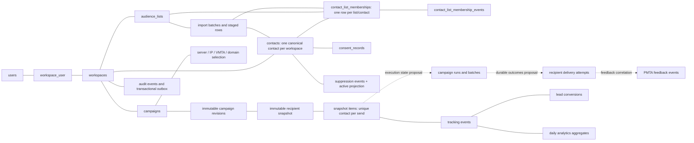

# AlphaLink production database blueprint — DMS evidence trace

**Status: DRAFT FOR DESIGN REVIEW.** This document maps audited DMS behavior to AlphaLink's current database and records a production direction. It is not a migration plan ready to run, a parity acceptance, or proof of 10-million-row performance.

## Purpose and evidence boundary

The DMS SaaS is the read-only behavioral reference; AlphaLink is the implementation target. DMS source, schema, browser observations, and available sanitized route evidence may be inspected to learn its behavior. No DMS customer/recipient rows or credentials are copied into AlphaLink as part of this work. User-supplied deployment artifacts are a separate infrastructure concern and are outside this database design. No DMS form, send, installer, provider mutation, or database write is used for discovery.

This draft uses the saved DMS audit reports and the current AlphaLink migration and service source. The DMS source snapshot cited in earlier reports is not present in this workspace, and the live DMS database catalog and recipient data were not queried. Therefore, DMS schema statements below mean **migration-source evidence recorded in the audits**, not a live database verification. Unknown sender behavior remains unknown. Refresh the relevant DMS source capture through the approved read-only path before accepting an implementation decision that depends on it.

Evidence labels used here:

- **OBSERVED** — directly represented in inspected source/migration or current AlphaLink code.
- **DERIVED** — follows from a traced source path, but was not observed as a live database outcome.
- **PROPOSED** — target design for AlphaLink; not a DMS behavior claim.
- **UNKNOWN** — current evidence does not establish the behavior.

**Fresh DMS SaaS observation (2026-10-27):** the repository's local authenticated relay accepted the read-only session bootstrap, returned the dashboard and `/admin/lists` with HTTP 200, and returned `/mailer/campaigns/create` with HTTP 200. The campaign form showed Offer/Country, ISP/List, Order By, Start From, and message/routing sections. The sanitizer removed private catalog options. The relay is configured to replace protected table/API requests with synthetic empty data before contacting DMS; no table/data endpoint was requested during this browser capture. No DMS rows were exposed. The browser only loaded the page and assets; no form was submitted and no product action was triggered. This confirms the visible campaign selection flow only; it does not establish DMS live database constraints, importer duplicate outcomes, or sender results. The observation used [`dms_reference_readonly_relay.py`](tools/dms_reference_readonly_relay.py); relay output contained status/path only.

## DMS reference model: what the evidence establishes

| Area | Evidence-backed DMS behavior/schema | Limit |
|---|---|---|
| Audience ownership | `lists` belongs to an ISP; migration-defined `emails` rows carry a `lists_id`, recipient attributes, and lifecycle type. DMS therefore stores each email row under one list in this schema. | Live constraints and row-level duplicate semantics are not verified. Do not infer that DMS enforces global uniqueness from `lists_id` alone. [`DATABASE_ARCHITECTURE.md`](DATABASE_ARCHITECTURE.md) |
| Segments and mixes | List/type selection is relational, while `virtual_lists` stores file and JSON mix metadata. Source code supports filtering by lifecycle type, offer exclusion, sex, creation range, domain extension, device, and event-log include/exclude criteria. | The native sender's final interpretation of every segment/config field is incomplete. [`CAMPAIGN_ORCHESTRATION.md`](CAMPAIGN_ORCHESTRATION.md), [`DMS_SENDING_DATAFLOW.md`](DMS_SENDING_DATAFLOW.md) |
| Campaign audience | Campaign creation applies recipient-state/list filters, offer exclusions, and suppression input, then writes a file-backed point-in-time recipient snapshot. The inspected PHP update path changes campaign settings without rebuilding that file. Associative keys collapse duplicate addresses in the snapshot path. | Snapshot encoding/order guarantees and exact sender consumption are unknown. The recipient file contents were not inspected. [`CAMPAIGN_ORCHESTRATION.md`](CAMPAIGN_ORCHESTRATION.md) |
| Suppression and consent | Suppression and offer exclusions are evidenced before snapshot generation; unsubscribe paths update recipient lifecycle/exclusion state. | An explicit consent lifecycle was not found in the inspected DMS recipient schema. The sender's final suppression check and treatment of stale snapshots are unknown. Do not claim DMS consent parity. [`DMS_SENDING_DATAFLOW.md`](DMS_SENDING_DATAFLOW.md) |
| Delivery and outcomes | DMS persists campaign state/history and has tracking, feedback, and daily-statistics tables. The native sender runs outside PHP and has only partial static analysis. | Per-recipient acceptance, retry/idempotency, durable delivery attempts, and completion reconciliation remain unknown. [`DMS_NATIVE_SENDER_ANALYSIS.md`](DMS_NATIVE_SENDER_ANALYSIS.md), [`DMS_SENDING_DATAFLOW.md`](DMS_SENDING_DATAFLOW.md) |

## Current AlphaLink database: observed structure and gaps

### Existing domains

- **Tenant/access:** `workspaces`, `workspace_user`, users, and scoped resource ownership.
- **Audience:** `contacts`, `audience_lists`, `contact_list_memberships`, membership events, list history, ISP linkage, and audience-mix snapshots/members.
- **Permission/suppression:** append-only `consent_records` and `suppression_events`; offer/list and drop suppression structures.
- **Campaign:** `campaigns`, immutable `campaign_revisions`, recipient snapshot headers/items, manual/test-mail attempts, and test addresses.
- **Engagement:** campaign/drop visitor events, lead conversions, PMTA feedback events, and daily analytics.
- **Offer and infrastructure:** workspaces, sponsors, offers/assets, managed servers/IPs/MTA mappings, domains, PMTA config/history, and provider settings.
- **Reliability:** `audit_events`, `outbox_messages`, Laravel queue/cache/job tables.

The detailed table definitions live in timestamped migrations under `apps/api/database/migrations/`. Relevant sources include [`2026_10_22_170000_create_alphalink_foundation_tables.php`](../apps/api/database/migrations/2026_10_22_170000_create_alphalink_foundation_tables.php), [`2026_10_22_180000_create_audience_lists_tables.php`](../apps/api/database/migrations/2026_10_22_180000_create_audience_lists_tables.php), [`2026_10_24_031710_create_campaign_recipient_snapshots_tables.php`](../apps/api/database/migrations/2026_10_24_031710_create_campaign_recipient_snapshots_tables.php), and the event/analytics migrations listed in the [migration inventory](../apps/api/database/migrations/).

### Verified scale and semantics gaps

1. **Cross-list membership is implemented locally; production gates remain.** A forward migration adds encrypted profile data to memberships. The importer reuses the workspace's canonical contact, creates an idempotent membership for each target List, preserves existing membership attributes on a plain-address reactivation, and leaves an opt_out membership inactive. The per-list membership API now allows a contact in another List. Isolated tests cover cross-list imports, API adds, same-List replay, encrypted per-List upload profiles, and Mix sex filtering from the selected membership (E-DB-06). This is an AlphaLink-approved deviation, not DMS parity. No PostgreSQL upgrade, rollback, concurrency, or production-volume test has run; the historical snapshot migration's `down()` still reintroduces workspace/contact uniqueness and is unsafe after cross-list data exists.
2. **The former 5,000-candidate import cap is removed in E-DB-08.** Raw API imports and uploaded files are staged privately and processed in resumable 500-row queue slices; DMS CSVs complete a streaming validation pass before database writes. PHP/Nginx upload-size directives in the Ubuntu installer are set to unlimited. This removes application byte/row ceilings but is not a 10M performance claim: disk capacity, queue throughput, PostgreSQL concurrency, and campaign snapshot memory still need production-scale validation. See [`ImportAudienceListContacts.php`](../apps/api/app/Services/Audiences/ImportAudienceListContacts.php).
3. **Campaign snapshot building is not memory-bounded at recipient scale.** Suppression IDs and list suppressions are loaded into PHP collections; accepted recipients and duplicate keys are accumulated in arrays, sorted/shuffled in memory, and only then inserted in 1,000-row chunks. Chunked inserts do not make the full build bounded-memory. See [`DmsCampaignRecipientSnapshotBuilder.php:72-110,127-243,249-294`](../apps/api/app/Services/Campaigns/DmsCampaignRecipientSnapshotBuilder.php).
4. **Filterable profile data is encrypted as one blob.** `Contact::$profile` is cast to encrypted JSON; the mix builder reads profile fields in PHP for at least sex and email-domain extension filters. That prevents those filters from using ordinary database predicates/indexes. See [`Contact.php:17-24`](../apps/api/app/Models/Contact.php) and [`BuildAudienceMixSnapshot.php:122-198`](../apps/api/app/Services/Audiences/BuildAudienceMixSnapshot.php).
5. **The database runtime is not established from this read-only pass.** The checked-in config defaults to SQLite and the queue config defaults to the database driver; `.env` and process overrides were not read. Production engine/queue and the current migration state are therefore unknown. See [`database.php:20`](../apps/api/config/database.php) and [`queue.php:16`](../apps/api/config/queue.php).
6. **Durable send execution schema is incomplete.** The migration inventory contains campaign snapshots and test attempts, but no campaign-run/batch/per-recipient delivery-attempt tables. DMS's sender outcomes are also unknown, so the exact state machine must be specified before claiming behavioral parity.
7. **Per-List imported profile preservation is implemented, but not yet query-scalable.** DMS-shaped uploads now write each row's encrypted profile to `contact_list_memberships.profile`; Audience Mix uses that membership profile for sex filtering and falls back to the canonical contact profile only for legacy rows whose membership profile is NULL. New plain-address memberships store an empty profile to avoid inheriting another List's attributes. The existing canonical `contacts.profile` remains for compatibility and is not overwritten by later List imports. Profile data remains an encrypted blob read in PHP, so typed/indexed segmentation fields and 100k–10M query plans are still required. DMS's one-List-per-email migration does not establish AlphaLink override semantics. See E-DB-05/E-DB-06.

**Migration rollback hazard:** the forward migration drops the `(workspace_id, contact_id)` unique constraint, but its `down()` recreates it. Once cross-list memberships exist, a blind rollback will fail. Production rollback planning must preserve forward-compatible data or explicitly reconcile memberships before rollback.

## Proposed production logical model for AlphaLink

This separates the observed DMS baseline from AlphaLink improvements. It is a logical design to validate, not a claim that the listed tables already exist.

### Core design decisions

| Decision | Production direction | Status and rationale |
|---|---|---|
| Relational engine | Use PostgreSQL as the production candidate, with SQLite reserved for fast local tests if the suite supports both. Require a clean-schema migration test and a representative workload benchmark before freezing the engine choice. | **PROPOSED.** The DMS audit records PostgreSQL as its configured engine; AlphaLink's checked-in default is SQLite. Production AlphaLink's active DB is unknown. [`DATABASE_ARCHITECTURE.md`](DATABASE_ARCHITECTURE.md), [`database.php`](../apps/api/config/database.php) |
| Tenant boundary | Keep `workspace_id` on every tenant-owned table; use composite foreign keys such as `(workspace_id, contact_id)` and `(workspace_id, list_id)` where possible. Keep cross-workspace contact existence private. | **PROPOSED**, building on existing composite-key patterns. Test tenant leakage and cross-tenant FK rejection.
| Contact identity | One canonical contact per `(workspace_id, normalized_email_hmac)`; encrypt email at rest. Version HMAC keys and define a collision/rotation migration before production. Never index encrypted ciphertext for dedupe. | **PROPOSED**, largely present in `contacts`; key rotation and large-scale rehash remain to be verified.
| Many-list membership | Permit the same workspace contact in any number of lists with unique `(workspace_id, audience_list_id, contact_id)`. Track each membership's own state/type, source, joined/left time, and event history. | **USER-REQUIRED** AlphaLink behavior. The importer and membership API currently violate it; repair must create/reactivate the selected membership when the canonical contact already exists. This is an explicit APPROVED_DEVIATION from DMS, whose migration evidence shows one lists_id per email row. Keep campaign-level uniqueness on `(snapshot_id, contact_id)` so selected overlapping lists yield one recipient per campaign send, matching the audited DMS snapshot dedupe behavior.
| Membership-scoped imported attributes | Keep each List import row's vertical/niche and provenance on that membership; separate contact-level identity/profile from source-row attributes. Use encrypted fields for sensitive values and typed/indexed columns or a governed attribute table for segmentation fields. | **PROPOSED AlphaLink extension** required by the user's multi-list/niche goal. Current upload stores the first row's entire profile on `Contact`; Mix is selected by membership but reads `Contact.profile`. DMS's one-List-per-email row cannot establish duplicate-across-List override semantics. Do not copy a shared profile to every historical membership when backfilling; only migrate facts whose source List is unambiguous, and preserve ambiguous legacy values at contact scope until their meaning is proven.
| Queryable attributes | Keep email/name and other sensitive fields encrypted or minimized. Store only fields needed for filtering (e.g. country, vertical, lifecycle/type, device, age band/sex if justified, created/joined times) in normalized typed columns or a queryable attribute table with explicit retention/access rules. Do not query inside an encrypted profile blob for 10M-row segmentation. | **PROPOSED** modernization. DMS migration source identifies recipient segmentation dimensions; AlphaLink currently encrypts the entire profile.
| Large imports | Add an asynchronous `import_batches` lifecycle (uploaded → validating → importing → completed/partial/failed), bounded streaming parser, staging/upsert path, per-file/per-row error counts, idempotent resume key, and progress checkpoints. For PostgreSQL, benchmark `COPY` to staging plus set-based merge against safe chunked inserts. Persist raw source files in private object storage with retention and checksum; do not send 10M rows in a web request or retain all rows in PHP arrays. | **PROPOSED.** The 5,000-row limit and in-memory parsing are confirmed AlphaLink gaps. Exact DMS maximum import size is unknown.
| Segmentation and mixes | Treat a saved mix as an immutable, expiring query snapshot with criteria hash, source list/type, counts, and stable row positions. Build/query it using indexed relational filters and bounded cursors; store criteria version so results are reproducible. | **PROPOSED** over the existing audience mix snapshot tables. DMS supports mix criteria and a recipient file snapshot; exact live mix refresh semantics need evidence.
| Suppression and permission | Retain append-only consent/suppression events for traceability and maintain a transactionally updated current eligibility projection keyed by workspace/contact/channel/scope. Check current eligibility immediately before a recipient is claimed/sent, while preserving the exact snapshot for audit. Scope suppression to workspace, offer, list, and channel only where the workflow requires it. | **PROPOSED** safety and performance improvement. DMS has source-observed suppression/offer exclusions; its consent model is unknown. AlphaLink currently plucks suppression IDs to PHP during snapshot build.
| Campaign snapshot | Keep campaign revision and recipient snapshot immutable. Materialize a deduplicated eligible recipient set in the database from selected memberships, mixes, offer suppression, workspace suppression, and eligibility policy. Record source, ordering seed, counts, suppression digest, and manifest digest. Use set-based SQL or bounded staging, not a full recipient array in application memory. Retain every selected, eligible source membership that contributed each deduplicated recipient in an immutable normalized relation; keep one send item per contact. | **PROPOSED** retaining DMS's point-in-time behavior while fixing scale. The user-approved AlphaLink rule fans open, click, and unsubscribe transitions out to every contributing selected membership. This is an explicit AlphaLink extension; DMS's single-list source model cannot establish it. Current snapshot schema already has useful immutability, digest, count, position, and uniqueness controls but only one source field.
| Send execution | Add `campaign_runs`, `campaign_run_batches`, and per-recipient delivery/attempt records only after the sender contract is evidence-mapped. Store idempotency key, claim/lease/attempt state, PMTA/transport result category, timestamps, and correlation IDs. Workers claim bounded batches and commit durable outcomes; do not create one queue job for every recipient or treat “queued” as “accepted.” | **PROPOSED / DMS UNKNOWN.** The AlphaLink migration inventory lacks these execution tables; DMS native sender result/retry semantics are unresolved.
| Queue/outbox | Commit state changes and an outbox event in the same DB transaction; publish outbox rows to workers with leases/retries and idempotent consumers. Use a separate queue backend for long-running imports/sends once the runtime topology is selected. Keep recipient payloads out of queue messages; pass run and batch identifiers. | **PROPOSED.** AlphaLink has `outbox_messages`; current queue config defaults to database. Active production override is unknown.
| Events and reporting | Make engagement and provider feedback append-only and idempotent with stable event identity. Keep daily/campaign/list/ISP aggregates as rebuildable projections. Partition high-volume append-only event/attempt tables by time only after query, retention, and maintenance benchmarks; avoid partitioning contacts/memberships before evidence justifies the complexity. | **PROPOSED.** Current event/aggregate tables exist; event volume and retention are unknown. DMS visitor table uniqueness is incomplete in inspected migration source.
| Database operations | Migrations must be forward-safe, restartable where possible, and exercised on an empty DB and an upgrade copy. Require automated backup verification and a successful restore drill before server migration; preserve audit and suppression records through cleanup. | **PROPOSED** production gate, particularly relevant after the prior data-loss incidents reported in this conversation. No server DB operation is authorized by this blueprint.

### Multi-list campaign provenance and tracking

The current snapshot item has one `source_list_id` and one `source_email_type`. `DmsCampaignRecipientSnapshotBuilder` deduplicates contacts with a set keyed by `email_lookup_hash`; after the first selected source, it skips later memberships and does not retain their provenance. `ProcessCampaignTrackingEvent` requires the callback `list_id` and type to match that one item, then transitions one current membership. This is internally consistent with DMS's migration-defined single-list email row, but it is insufficient for AlphaLink's approved multi-list target when one campaign includes the same contact through several selected Lists.

**User-resolved AlphaLink behavior (E-DB-03):** when an open, click, or unsubscribe belongs to a deduplicated recipient, apply that transition to every selected, eligible source-list membership that contributed the recipient. Do not fan out to unselected Lists, unrelated memberships, or source rows removed by campaign eligibility/suppression. This is an explicit AlphaLink extension; DMS's one-list migration does not establish equivalent semantics.

**PROPOSED target shape:** keep one recipient snapshot item per contact/send, and add an immutable normalized source-membership relation recording every contributing membership ID, source List ID, source email type, and snapshot position/state needed to explain inclusion. A tracking callback must resolve to the item and its frozen source memberships, never infer attribution from all current workspace memberships or current List contents. Persist one engagement event per actual recipient action and deduplicate callback retries using a stable sender event ID if the source contract provides one; the sender's retry identity remains UNKNOWN, so do not collapse distinct opens/clicks with a coarse action fingerprint. Append one membership event for each affected membership with a unique `(engagement_event_id, membership_id)` idempotency boundary. Apply offer-level unsubscribe suppression once per contact/offer while updating each contributing membership. If tracked-country routing moves memberships, route each contributing membership according to its own source ISP; if multiple rows converge on the same destination List, transactionally reuse a canonical destination membership, preserve all source histories/lineage, and apply an explicit lifecycle-state merge rule (unsubscribe/suppression must dominate). Confirm that rule against source behavior before freezing it. Do not mark list-history/tracking parity complete until fan-out, retries, country moves, and collisions are implemented and tested.

## Indexing and scale validation

Indexes must follow measured query plans rather than being added indiscriminately. Initial access paths to benchmark include:

- Workspace contact dedupe: unique `(workspace_id, email_lookup_hash)`.
- List scan and selected type: `(workspace_id, audience_list_id, status, email_type, joined_at, id)`; verify ordering and keyset/cursor behavior at 10M rows.
- Reverse membership lookup: `(workspace_id, contact_id, status)`.
- Import idempotency: `(workspace_id, import_batch_id, normalized_hash)` in staging; uniqueness on final contact and membership keys.
- Snapshot traversal: `(workspace_id, snapshot_id, position)` and unique `(snapshot_id, contact_id)`.
- Active suppression check: `(workspace_id, contact_id, scope_type, scope_key, effective_at)` on the current projection; event log indexes separately support rebuild/audit.
- Events/analytics: workspace plus event time and the actual dashboard dimensions; every extra dimension index increases ingest/storage cost.

The benchmark must include a 10M-row list, repeated contacts across lists, high duplicate/suppression rates, concurrent imports, campaign snapshot builds, opt-outs during an active run, and event ingestion. Measure import and snapshot throughput, peak app memory, database size/index growth, query plans, lock waits, and p95/p99 latency. Define numeric service targets before implementation; none are invented here, and no 10M benchmark has been run.

## Production database implementation map

This is the proposed dependency order for AlphaLink. DMS is a read-only behavior reference; all schema work, fixtures, benchmarks, and UI/API changes begin in the local checkout and disposable databases. Existing saved app data is not a test fixture.

| Phase | Build | Exit gate |
|---|---|---|
| 0. Source contract | Finish read-only DMS tracing for import duplicate rules, eligibility/suppression, campaign snapshot ordering, send outcomes, callback identity, and retention. Keep source facts, user-approved AlphaLink extensions, justified modernization, and unknowns labeled separately. | Every implementation rule has a source/evidence reference or an explicit AlphaLink decision. No recipient rows, credentials, production data, or DMS mutation is used. |
| 1. Contact and membership | Keep one workspace-scoped canonical contact keyed by normalized-email HMAC; allow many memberships with unique `(workspace_id, audience_list_id, contact_id)`. The first local implementation is in place: cross-List import/API adds, encrypted membership profiles, Mix profile scope, same-List replay handling, and opt-out preservation. | Isolated SQLite tests pass for import/upload, API membership, and selected-List Mix filtering. Still require a disposable PostgreSQL upgrade/constraint check, concurrency tests, a forward-recovery plan, and parity/browser evidence. The new profile migration blocks its own data-losing rollback; the historical snapshot migration `down()` still must not run after cross-list data exists. |
| 2. Import pipeline | Add durable import batches, private file storage/checksum, streaming parsing, staging rows, per-row result counts, resumable checkpoints, and set-based upsert into contacts/memberships. Keep raw email encrypted and access-controlled; do not hold 100k–10M rows in PHP arrays. | Replaying a batch does not duplicate contacts/memberships or counters; interrupted batches resume; malformed rows are auditable; 100k and 10M benchmarks meet targets for time and peak memory. |
| 3. Segment and suppression reads | Promote filterable fields into typed/indexed columns or a governed attribute table. Keep append-only consent/suppression events and a transactional current-eligibility projection. Evaluate suppression in SQL at snapshot build and again immediately before a recipient is claimed. | Filters use indexed query plans; opt-out/import/send races have deterministic tests; workspace and offer scopes cannot leak across tenants. |
| 4. Campaign audience snapshot | Build the eligible set with SQL or bounded staging. Store one immutable recipient item per contact and an immutable contributor row for every selected eligible membership. Preserve deterministic position, source type, selection criteria, counts, suppression digest, and recipient manifest digest. Backfill existing snapshots from their current single source before relying on the new relation. | Overlapping lists send one recipient; every selected contributing membership is retained; excluded/unselected memberships are absent; retries rebuild the same digest; peak memory stays bounded. |
| 5. Send run and attempts | After source review establishes the sender contract, add durable run, batch, recipient claim/lease, and delivery-attempt records plus an outbox. Workers claim bounded batches, recheck current suppression, record transport acceptance separately from delivery, and recover expired leases. Do not enqueue one job per contact or mark queued as sent. | Crash/retry/concurrency tests show no double claim or lost result; an accepted send is not repeated after an uncertain response; operational metrics and stop/pause semantics are defined. Native DMS sender outcomes remain UNKNOWN until proven. |
| 6. Tracking and membership lifecycle | Resolve each callback to the immutable campaign recipient. For open/click/unsubscribe, fan out once to each contributor recorded at snapshot time; do not query current unrelated memberships. Use a stable sender event ID for callback retries if available, then use a unique engagement-event/membership key for worker fan-out. Keep offer-level unsubscribe suppression once per contact/offer. Handle country-list destination collisions transactionally while preserving source lineage and history. | Tests cover legitimate repeated opens, callback replay, worker retry, list removal after send, all selected contributors, unselected lists, unsubscribe precedence, and tracked-country collisions. Native callback identity remains a release blocker until sourced. |
| 7. Analytics and retention | Make event, feedback, and membership history append-only; build daily/list/campaign/ISP totals as rebuildable projections. Choose retention and any event partitioning from measured volume and restore needs. | Full rebuild matches incremental totals; duplicate imports/events cannot inflate projections; archival/deletion preserves consent, unsubscribe, and audit evidence. |
| 8. Deployment and operations | Add forward-safe expand/backfill/contract migrations, automated encrypted backups, monitored backup age, and a verified restore drill. Test on a disposable PostgreSQL database and isolated Ubuntu 26 staging before production. | Clean install, upgrade, interruption/restart, rollback or forward-recovery, backup restore, load, queue recovery, and browser/API acceptance gates all pass. No live production migration until the full release review is approved. |

## Exact work sequence from this blueprint

1. Complete the DMS read-only source review for import/deduplication, consent/suppression, campaign snapshots, and delivery outcomes. Update evidence labels; never query DMS recipient rows or mutate the DMS SaaS.
2. Keep the user-resolved AlphaLink multi-list and event-fan-out semantics fixed (E-DB-03). Contact/membership profiles and cross-List import are implemented locally (E-DB-06); immutable campaign snapshot contributors and selected-membership open/click/unsubscribe fan-out are now implemented locally (E-DB-07). Next resolve durable import/resume, indexed attributes and analytics attribution, then suppression, send runs, sender retry identity, retention, and PostgreSQL/queue topology.
3. Write the versioned schema/migration plan and index plan. Do not run migrations against the live server.
4. Implement in the local AlphaLink checkout with synthetic fixtures; execute database-engine-specific migration, concurrency, correctness, and volume tests. Do not apply these changes directly to the live app/server database.
5. Validate in an isolated Ubuntu 26 staging environment after backup/restore procedures pass. Consider production only after app, data, browser parity, and rollback evidence is complete.

## Acceptance gates for the database slice

- Every DMS-derived entity/rule names a source route/file and evidence class; UNKNOWN sender/database behavior remains open.
- One normalized workspace contact can join multiple lists; re-import is idempotent per target list; one contact appears at most once in a campaign snapshot.
- Large file import and snapshot construction have bounded memory, restartable progress, transaction-safe counters, and no partial-success ambiguity.
- Suppression and permission checks are correct under concurrent unsubscribe/import/send timing and do not leak contacts between workspaces.
- Migration tests cover empty install, upgrade, interrupted recovery, and restore from backup. Tests run on the chosen production engine.
- Representative 10M-row benchmark meets explicitly agreed performance/operational targets; schema diagrams alone do not establish scale.
- Browser parity is verified for the affected DMS audience/campaign flows; database correctness alone does not establish feature parity.

## Open evidence/questions

- Live DMS catalog and server version are not verified; source-migration evidence is the current ceiling.
- DMS global uniqueness and exact import duplicate outcomes require source recheck; no recipient rows were queried.
- Exact native sender input format, per-recipient acceptance, retries, and completion reconciliation remain unknown.
- The running AlphaLink DB/queue engine, current migrations, actual row counts, and production topology were not inspected; `.env` and secrets were not read.
- No schema/migration/code change, production query, or DMS action was performed to produce this blueprint.

## E-DB-07 — Selected-source provenance and event fan-out — 2026-10-27

The local implementation now has immutable `campaign_recipient_snapshot_item_sources` rows for each selected contributor and `campaign_engagement_event_sources` rows for source attribution on a canonical event. Snapshot revision copies preserve contributor rows. Callback validation accepts a source only when it belongs to the immutable recipient snapshot. The queue processor writes a single engagement event and performs idempotent open/click/unsubscribe membership transitions for every selected contributor, leaving unselected memberships alone; offer-level suppression remains once per contact/offer. PostgreSQL 18 fresh migrations and focused synthetic tests pass (CampaignTrackingTest 26/174, AudienceMixWorkflowTest 6/52, selected catalog test 1/172).

Remaining release gaps: daily per-list analytics still keys off canonical event source; sender-provided stable callback retry identity is UNKNOWN; tracking and queue behavior were not exercised against a running production-like app; source country-list destination collision behavior is a conservative AlphaLink choice and UNKNOWN versus DMS; snapshot construction is now PHP-memory-bounded with database staging (E-DB-10); actual 10M throughput remains unbenchmarked; PostgreSQL concurrency, browser parity, restore drills, and historical rollback safety remain unverified. The full campaign catalog suite has 6 failures and 1 error in legacy route/settings/auth assertions. No DMS state or real AlphaLink database row was changed.

## E-DB-10 — Bounded campaign snapshot construction — 2026-10-27

The send snapshot path now uses stable keyset reads rather than offset-based lazy scans, SQL suppression probes rather than whole-workspace suppression arrays, and connection-scoped temporary tables for recipient dedupe/source aggregation and email sorting. It hashes ordered pages and writes durable immutable item/source rows in batches. Selected-source provenance and revision-copy reads also use 1,000-row keyset pages, so PHP memory stays bounded as cross-list fanout grows. Composite indexes support the membership, mix, and suppression lookup predicates; PostgreSQL creates them concurrently to avoid a blocking index build during a data-bearing upgrade.

The current SQLite tests pass for 1,002 deduplicated recipients, 2,002 source-provenance rows, and revision-copy preservation (**2 tests / 178 assertions**). An earlier disposable PostgreSQL 18 test predates current provenance paging and the concurrent-index migration, so the latest PostgreSQL behavior is unverified. This removes recipient-count-proportional PHP arrays, but it is not a throughput claim. The user clarified that the local machine's capacity is irrelevant to the production target. The 100 MB List, 700 MB suppression file, and 10M contact workloads still require measured target-server throughput, storage/temp-space planning, PostgreSQL concurrency testing, queue tuning, and backup/restore verification.

## E-DB-11 — Target-derived production queue sizing — 2026-10-27

The Ubuntu 26 installer no longer writes fixed two-worker values for the default and audience-import Horizon supervisors. It previews sizing before package changes and derives the final counts from effective target CPU, cgroup-aware RAM, and the installed PostgreSQL `max_connections`. The budget keeps half of RAM available for PostgreSQL, PHP-FPM, Valkey, Nginx, OS and temporary work, uses a conservative per-worker budget, reserves ten PostgreSQL connections for web/operations, and assigns roughly a third of Horizon workers to resumable imports. This is target-resource-aware concurrency, not a cap on records or file bytes. Synthetic calculator cases and shell/plan checks pass. No target Ubuntu install, production-sized file transfer, PostgreSQL contention test, or 10M benchmark has been run; keep production capacity unverified until exercised on the actual server.

## E-DB-12 — Import batch terminal-state safety — 2026-10-27

A delayed queue failure previously selected and updated an import batch outside a transaction, leaving a race in which it could overwrite a concurrent completion. Failure finalization now locks the row, rechecks that it is nonterminal, writes failure state transactionally, and deletes the private staged file only after commit. Job exception details are no longer exposed through the batch status response. Synthetic SQLite regressions verify that a late failure cannot alter a completed batch and that row data embedded in an exception stays out of the public status. The focused import/upload suites pass 21/145. PostgreSQL row-lock concurrency and real Horizon retries are still required before production acceptance.

## E-DB-13 — PostgreSQL 18 clean-schema migration verification — 2026-10-27

A fresh disposable PostgreSQL 18.6 instance accepted all 82 current AlphaLink migrations. The composite campaign keyset/mix/suppression indexes are present after the nontransactional concurrent-index migration. This updates the earlier E-DB-10 migration gap: the *current clean install schema path* is now verified on the selected PostgreSQL major. It does not prove upgrade behavior on existing records, campaign builder query correctness under PostgreSQL, row-lock races, concurrency/load, backup/restore, 100 MB/700 MB handling, or 10M throughput. The container used loopback only and ephemeral storage, then was stopped and discarded; no saved application or DMS database was used.
