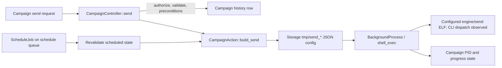

# DMS Campaign Orchestration

**Status: PARTIALLY VERIFIED from static backend source.** No campaign endpoint, sender, scheduler, or production job was invoked.

## Evidence and observed call path

Source references below use deployed paths and line numbers; no source files were copied into the workspace.

| Stage | Finding | Evidence / confidence |
|---|---|---|
| Send authorization and validation | `CampaignController::send` authorizes `is-campaign-owner`, validates `status` as `send` or `kill`, validates numeric pacing/seed fields, and restricts `send_type` to eight modes (`delay`, `delayp`, `delayps`, `hs`, `hsp`, `hsps`, `pickup`, `pickups`). | **OBSERVED**, `/var/app/app/Http/Controllers/Mailer/Campaign/CampaignController.php:699-807` and `/var/app/app/Providers/AuthServiceProvider.php`. Static policy was inspected; no authorization test was run. |
| Pre-send checks | The send branch rejects an existing active PID, campaigns older than the configured expiry, missing test recipients/header/IPs, and a missing prebuilt `send_file`. It then creates a send-history row. | **OBSERVED**, same controller range. These checks do not establish audience correctness or approval policy. |
| Send configuration | `CampaignAction::build_send` assembles campaign/send/user identifiers, username, batch/pacing/seed values, duplicate-data setting, Artisan path, and ISP quality-email settings; JSON is base64-encoded and written via Laravel Storage under `tmp/send_*`. | **OBSERVED**, `/var/app/app/Actions/CampaignAction.php:293-328`. The file is runtime state; it was not opened. |
| Process launch | `get_send_command` formats `nohup <configured send_path> send_<mode> <config-path>`. `BackgroundProcess::run` launches this through `shell_exec` with output redirected to `/dev/null` and captures a PID. The controller checks the process and persists send mode, parameters, PID, and `progress` state. | **OBSERVED**, `CampaignAction.php:565-569`, controller `:699-807`, `/var/app/app/Libraries/BackgroundProcess.php:41-63`, `CampaignAction.php:448-470`. |
| Campaign state | The model exposes `send_status`, `send_progress`, `send_count`, `send_pid`, `send_parameters`, scheduling fields, `is_active`, `is_restricted`, and a `campaign_type`; arrays and scheduled time are cast. It relates to user, ISP, offer, history, send logs, and visitors. | **OBSERVED**, `/var/app/app/Models/Campaign.php:20-138`. Live schema/state was not queried. |
| Scheduling | `CampaignAction::schedule` dispatches a unique queued `ScheduleJob` on queue `schedule`, delayed until the requested time, then stores `scheduled` status and parameters. `ScheduleJob` rechecks existence, scheduled flag, restriction/activity, matching timestamp, and send-file presence before launching campaign, Gmail campaign, drop, or warmup flows. | **OBSERVED**, `CampaignAction.php:486-517`, `/var/app/app/Jobs/ScheduleJob.php:22-180`. Redis/Horizon config is documented in [MAIL_INFRASTRUCTURE.md](MAIL_INFRASTRUCTURE.md); active runtime override/process state remains unknown. |
| Stop behavior | `CampaignAction::kill` issues `kill -9` for the stored PID, then resets status/PID/schedule fields. This is a forceful process stop path. It was only read statically and never called. | **OBSERVED**, `CampaignAction.php:473-484`. No graceful shutdown or process identity validation is visible in this method. |
| External sender | The configured path is `storage/app/engine/send`; `send1` is also present. REA verifies that the ELF is a .NET 7 apphost and forwards arguments to its bundled managed `send.dll`. The managed payload reads the PHP-provided config file, and a reachable worker opens `TcpClient(host,port)`, writes line-oriented text, and parses SMTP-shaped replies. | **PARTIAL:** SMTP compatibility is the leading static inference; command text, PowerMTA peer identity, message/MIME construction, recipient meaning, transport outcomes and recovery remain unknown. The PHP source selects `send`, not `send1`; exact evidence and limits are in [DMS_NATIVE_SENDER_ANALYSIS.md](DMS_NATIVE_SENDER_ANALYSIS.md). Neither sender was executed.
| SMTP helper | `App\Libraries\Send\Helpers\Smtp` uses `fsockopen` to the configured PMTA port, writes `MAIL FROM`, `RCPT TO`, `DATA`, message header/body, and X-ENVID/X-JOB/X-VIRTUAL-MTA fields; it reconnects after 250 messages. It reads replies only during `QUIT` and loops until EOF. No TLS, SMTP AUTH, reply-code parsing, or call site was established in this class. | **OBSERVED**, `/var/app/app/Libraries/Send/Helpers/Smtp.php:19-89`. Whether this class is used by the ELF sender is **UNKNOWN**. |

## Static lifecycle map

The diagram is a source-derived control path, not evidence of current process or queue activity.

## Campaign creation, recipient snapshot, and personalization

- `CampaignController::store` validates offer/ISP IDs, one or more selected lists, ordering (`default`, `asc`, `desc`, `random`), content/header/assets, routing mode, servers/IPs, placeholders, pacing, seed cadence, bounce limit, send mode, duplicate-data value, and a `store_send` flag. **OBSERVED** at `/var/app/app/Http/Controllers/Mailer/Campaign/CampaignController.php:189-326`.
- The `store_send` branch can launch a process immediately after creation. It is therefore an action-bearing campaign creation route, despite being the ordinary create endpoint. It was not called.
- `CampaignAction::create_campaign` removes PHP memory/time limits, gives suppression up to 30 minutes, constructs `Suppression`, and creates the campaign only after suppression returns a recipient file. It stores selected list/type values, offer, ISP, message assets/content, MTA/VMTA selection, server/IP arrays, pacing values, bounce limit, and file path. **OBSERVED** at `/var/app/app/Actions/CampaignAction.php:22-110`.
- `Suppression::load_emails` reads either selected `emails` rows or a virtual-list mix file. For ordinary list rows, `EmailAction::suppression` filters by list and selected recipient type and excludes addresses whose `excluded_offers` contains the current offer. For a virtual list (`mix`), `Suppression` reads every stored mix row directly and does not reload its current email type or `excluded_offers`; the offer's separate suppression file is then applied and matching addresses are removed. The remaining records are written to a local send file; associative keys collapse duplicates. **OBSERVED** at `/var/app/app/Libraries/Suppression.php:49-164` and `/var/app/app/Actions/EmailAction.php:86-94`.
- **High-priority derived risk:** the reply-extractor builder explicitly places `Email::UNSUBSCRIBE` records into its virtual mix (`EmailAction.php:141-159`). If that `reply-<name>` audience is selected for a campaign, those rows can enter the campaign send snapshot unless the separate offer suppression file removes them. The PHP path does not recheck lifecycle state or offer exclusions in the virtual-list branch. Whether the native sender later excludes such rows is unknown; no campaign was created or sent.
- The campaign file is a point-in-time audience snapshot; later campaign edits update content/routing/pacing and create an update-history record, but the inspected update function does not rebuild the audience file. This is **DERIVED** from `create_campaign` and `update_campaign` source.
- `EmailAction::create_user_mix` supports filters on recipient state, sex, creation range, email-domain extension, tracked device, and event-log include/exclude selectors and date range, then writes a virtual mix file. **OBSERVED** at `/var/app/app/Actions/EmailAction.php:21-84` and `/var/app/app/Libraries/MixWriter.php:21-47`.
- `CampaignAction::Build_token` constructs a Base64 token containing campaign/send/email/type/list/ISP/server/IP/domain/from/subject/creative identifiers, a `uniqid()` value, and Adler-32 checks. This is not a cryptographic MAC in the inspected code. `generate_body` replaces `[token]` and applies a `random()` transformation. **OBSERVED** at `CampaignAction.php:519-563`; token verification and sender use remain unknown.

## Configuration and reliability observations

- **OBSERVED:** `store_send` permits immediate launch at campaign creation; standard `send` and `schedule` endpoints are separately action-bearing.
- **OBSERVED:** creation performs synchronous recipient/suppression file construction before campaign persistence, with PHP memory limit disabled and execution time extended to 30 minutes.
- **OBSERVED:** helper commands `head` and `sort` are invoked using path strings from stored/configured file paths. The inspected source does not show shell escaping at these call sites. This is a static risk observation, not evidence of exploitation.
- **UNKNOWN:** exact `send_file` format consumption, recipient chunking, personalisation expansion, header/MIME creation, attachment support, send deduplication, MTA failover, and process exit-to-campaign-state reconciliation. These are likely inside the uninspected sender binary or additional code.
- **UNKNOWN:** whether offer suppression files are refreshed, how stale file versions are handled, and whether suppression changes after campaign creation affect already-generated audience snapshots.

## Reliability and security observations

- **OBSERVED:** launch uses shell command strings; `send_type` is enumerated at the controller boundary, while the configuration-file path is created by application code. `BackgroundProcess` itself uses `shell_exec` and redirects output to `/dev/null`.
- **OBSERVED:** campaign stop uses `kill -9` directly on a stored PID; process ownership/identity is not revalidated in `CampaignAction::kill`.
- **OBSERVED:** the controller has explicit “already running,” expiry, required-field, and send-file checks. The scheduled job also checks the schedule timestamp and active/restricted state.
- **UNKNOWN:** sender internals, batching semantics, recipient query/segmentation, suppression, idempotency beyond `ScheduleJob::uniqueId`, concurrency locking, retry behavior, result reconciliation, and completion-state updates.
- **UNKNOWN:** whether the raw SMTP helper participates in campaign sending. It may belong to another subsystem.
- No real/test email, campaign action, test/body generation, or queue job was triggered.

## Parallel send paths

### Drops

- `DropController::send` authorizes `is-drop-owner`, validates offer/sponsor, lists, routing, content, placeholders and pacing, verifies selected lists have suppression for the offer, persists send parameters, then either schedules or calls `DropAction::send` (`/var/app/app/Http/Controllers/Mailer/Drop/DropController.php:222-305`).
- `DropAction::send` creates a base64 JSON config containing drop/list/filter/country/offer/ISP, MTA/IP/server, pacing/batch, test cadence, assets and quality-email fields; it launches `config('system.send_path') drop_<mode> <config>` through `BackgroundProcess` and persists PID/progress (`/var/app/app/Actions/DropAction.php:528-605`). Test mode similarly launches `drop_test_<mode>` with a 30-minute timeout (`:455-509`). Scheduling uses the shared `ScheduleJob` on the `schedule` queue (`:511-525`).
- **Important method-safety evidence:** the authenticated GET route `/mailer/drops` calls `DropAction::init_drop`, which creates an unprocessed `Drop` row when no draft exists (`DropController.php:35-40`; `DropAction.php:24-36`). GET `/mailer/drops/{drop}/clone` creates a cloned row (`DropController.php:307-314`), and GET `/mailer/drops/{drop}/clear` clears an unprocessed draft (`:365-376`). These GETs are **state-changing** and were not requested. This confirms why HTTP method alone is not a safety signal.
- Pause/resume/kill/restrict/suppression operations are action-bearing. The pause/resume and kill controller methods use owner authorization; suppression start creates a record and launches an Artisan process; kill uses `kill -9` (`DropController.php:316-362,482-529`; `DropAction.php:329-369`). None was used.

### Warmups and seed lists

- `WarmupController::store` creates a `SeedCampaign` through `SeedCampaignAction`; its `store_send` boolean can immediately build send config and launch `warmup_<mode>` using the same configured native sender (`/var/app/app/Http/Controllers/Mailer/WarmupController.php:218-314`; `/var/app/app/Actions/SeedCampaignAction.php:218-249`).
- Warmup send validates pacing, seed interval and one of the eight native sender modes, then builds config and starts the process; schedule dispatches `ScheduleJob` to the `schedule` queue; resend starts a fresh process. These actions authorize `is-warmup-owner` (`WarmupController.php:391-550`; `SeedCampaignAction.php:240-275`).
- `SeedCampaignAction::update_seed_campaign` kills a currently progressing warmup before saving changed settings (`/var/app/app/Actions/SeedCampaignAction.php`, method beginning at line 83); this is a side effect of the update path. Warmup delete, seed-list upload/clean/status/delete and email editing routes are likewise state-changing and were not invoked.
- The underlying `warmup_*` sender mode, seed rotation, failure recovery and bounce enforcement remain inside the uninspected ELF or unreviewed surrounding source.

### Google-linked campaigns

- The route group is conditionally registered when `config('system.gsend_allow')` is true and requires the `gmail_send` role (`/var/app/routes/mailer.php:129-186`). `GcampaignAction::create_campaign` runs the same suppression builder, writes a `campaign_type='gcampaign'` campaign and its send-file path (`/var/app/app/Actions/GcampaignAction.php:16-97`).
- `GcampaignController::send` checks campaign ownership, validates only `delay`/`delayp`, checks running/expiry/required fields and live offer, then launches `php artisan gcampaign:send` as a background process; `send_drafts` launches another Artisan command. Schedule is a separate owner-gated path (`GcampaignController.php:458-644`).
- `GcampaignSend` reads recipient lines from the campaign file, rotates From/Subject/placeholders, personalizes header/body, calls `GmailLib::send` or creates drafts, updates progress/statistics and sends seed/test messages at the configured interval. The parallel mode uses `Fork::new()->concurrent(100)` (`/var/app/app/Console/Commands/gcampaigns/GcampaignSend.php:27-174,221-320,323-425`). This is a separate send system from the native ELF/PMTA path.
- `GmailLib` uses Google OAuth tokens and Gmail API `users_messages->send`; it builds a base64url-encoded raw message from header and body. Its configured scopes include broad mail and settings scopes (`/var/app/app/Libraries/GmailLib.php:23-47,164-187`). No Google authorization, API call, message, draft or account record was accessed.

### Global tests

`POST /mailer/global-tests` synchronously builds a config and executes the native `global_test` sender for up to 30 minutes; successful output is persisted to a global-test history record (`/var/app/app/Http/Controllers/Mailer/GlobalTestController.php:36-108`). It is a send operation despite being called a “test.” The route was not invoked.

## Remaining evidence

The largest campaign/send unknowns are the native sender’s internal batching, MIME construction, transport, retries and exit-state reconciliation; the PHPMailer discrepancy; and runtime effects inside the uninspected binary. Seed-list lifecycle and some Gmail parallel/error recovery details remain partial. Treat all send/test/kill/schedule, OAuth, seed import, and ambiguous data-loader routes as forbidden to call.
