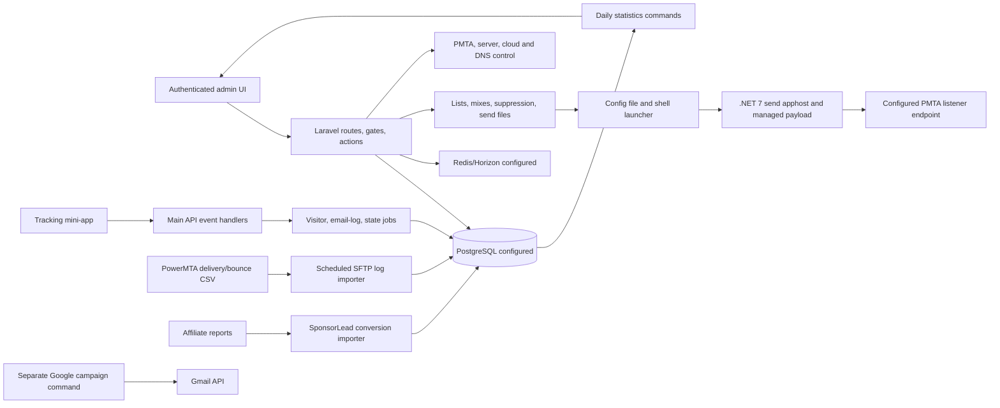

# DMS reverse-engineering conclusion

**Date:** 2026-10-22  
**Scope:** The DMS reference application: authenticated frontend, deployed Laravel backend and migrations, shipped tracking mini-app, and the `send`/`send1` artifacts inspected offline with REA. This report describes DMS. It makes no AlphaLink implementation or technology decision.

## The conclusion

DMS is a Laravel 10.38.2 / PHP 8.1.27 administrative application behind Nginx and PHP-FPM, configured for PostgreSQL and Redis/Horizon. It manages recipients and ISP/list groupings, builds file-backed campaign audiences, launches a separate .NET 7 Linux sender for standard campaigns, and has a distinct Gmail API send path. Public tracking routes, PMTA delivery/bounce file imports, affiliate conversion imports, and scheduled aggregation feed its reporting. Its server-control plane can install and manage PowerMTA, DNS, cloud instances, and related mail infrastructure.

This is a **complete conclusion at the available read-only evidence boundary**, not a claim that every live DMS outcome is known. Backend source and shipped artifacts establish the flows below. The sender's literal modes, SMTP commands, configured PMTA listener contract, and durable progress/status SQL are now reconstructed. Exact final message bytes, recipient acceptance, retries, and live delivery remain unproven. Live database contents, effective settings, provider accounts, PMTA configuration and production event accuracy were not inspected. See the [sender resolution](DMS_REA_SENDER_RESOLUTION_2026-10-22.md).

The most important distinction is that DMS has **three separate feedback channels**: recipient engagement through the tracking mini-app/API, delivery and bounce files imported from PMTA, and leads/revenue imported from affiliate reports. The audited source does not establish an exact end-to-end join between the native sender's immediate reply, a delivered mailbox message, a tracking token, and a later PMTA or affiliate row.

## Evidence and confidence

| Evidence class | What was directly inspected | Limit |
|---|---|---|
| Frontend observation | On 2026-10-20, authenticated DMS page HTML, navigation, form labels and same-origin JavaScript were read. The dashboard title identified DMS. See [frontend audit](DMS_REFERENCE_AUDIT_PHASE_1.md) and [route inventory](DMS_REFERENCE_ROUTE_EVIDENCE.md). | Dynamic tables and records were not loaded; a visible button does not prove its server behavior. Some GET pages have source-confirmed side effects. |
| Backend source | Deployed `/var/app` Laravel routes, controllers, actions, models, migrations, jobs, commands, adapters and selected host metadata were read during earlier verified read-only SSH sessions. See [evidence index](DMS_RECONSTRUCTION_EVIDENCE.md) and the topic reports linked below. | Source states what a build implements, not which accounts, settings, jobs or provider integrations are active now. A fresh selected source snapshot (645 files) was copied read-only to a private temporary directory on 2026-10-22; `.env` and database rows were excluded. |
| Shipped tracking app | An offline archive of the installed mini-app was inventoried and inspected; its SHA-256 is `be4c6fc20e109f57f532715727c9e305521fb6c8c9cad9438da9cd51412f921a`. See [tracking flow](DMS_TRACKING_ATTRIBUTION_FLOW.md). | No pixel, redirect, opt-out or API request was exercised. |
| REA/Ghidra sender analysis | Read-only copies of `/var/app/storage/app/engine/send` and `send1` matched their recorded remote SHA-256 values. The ELF apphosts, bundled .NET manifests, managed metadata and selected CIL/call paths were inspected. See [native sender analysis](DMS_NATIVE_SENDER_ANALYSIS.md). | Static call reachability is not execution. The managed string resolver was reconstructed offline and 936 literal references decoded; no sender was run. See [sender resolution](DMS_REA_SENDER_RESOLUTION_2026-10-22.md). |
| Current access check | On 2026-10-22, the configured frontend authenticated through its proxy and reached `/dashboard/main`. Direct SSH matched the configured ED25519 fingerprint and authenticated as root. Read-only transfers of `send`/`send1` matched the historical hashes; selected current backend-source hashes were rechecked. | No database row, PMTA configuration, provider account, sender execution, campaign or message was inspected or triggered. Authentication and hash matches do not establish live behavior. |

**Access and evidence correction:** direct SSH with the saved `.env` root credentials and strict ED25519 fingerprint check succeeded. The frontend authenticated through the configured proxy. Fresh `send`/`send1` copies matched historical SHA-256 values. A selected current backend source snapshot was copied read-only (645 files, manifest SHA-256 `10bf645aea60eb53784c4a06fa00402c89b9613c99a5f1c47a9c9ef30b6c7ca2`). REA confirmed the configured managed payload and full CIL metadata in [the exported evidence bundle](DMS_REA_REFRESH_EVIDENCE_2026-10-22.json). Supplementary static resource/CIL decoding resolved the sender's modes, SQL, and SMTP literals. See the [sender resolution](DMS_REA_SENDER_RESOLUTION_2026-10-22.md). The cause of the earlier SFTP failure is not established; it was a failed attempt, not a lack of valid credentials.

In this report, **source verified** means the cited code path or migration was inspected; **REA verified** means a static artifact fact was tied to a recorded hash; **derived** means several verified paths were joined by analysis; and **unknown** means the available evidence cannot establish the behavior.

## System and execution map

The sender's intended endpoint is `Server::ip` plus `settings.pmta_port`, the same setting used by PMTA installation source. Native code reads `main_ip`/`main_port` and constructs SMTP commands. This is a verified source/artifact configuration contract; no live socket or PMTA configuration was captured. The PMTA importer is a separate verified source path; the direct relationship between a sender reply and an imported PMTA row remains unknown.

## 1. Users, recipients, lists and ISPs

An ISP in DMS is an application grouping and access/routing object, not a verified external ISP API. Its model carries allowed users/sponsors, tracked countries and quality-email settings; ISP access changes are propagated to its lists. Each list belongs to one ISP and carries access/sponsor controls, activation, per-recipient-state locks, and a tracking flag. The inspected `emails` migration gives each recipient one `lists_id` and a globally unique address, so this schema supports one list membership per email address. These are schema/source facts; live rows and effective permissions were not read. Sources: `/var/app/app/Models/Isp.php`, `Lists.php`, `Email.php`, `app/Actions/IspAction.php`, `ListsAction.php:71-165`, and the `create_isps`, `create_lists`, `create_emails` migrations; see [database architecture](DATABASE_ARCHITECTURE.md) and [Phase 4B](DMS_PHASE_4B_REASSESSMENT.md#direct-answers-to-the-owners-questions).

List import lowercases and validates addresses and uses PostgreSQL `ON CONFLICT DO NOTHING`. Re-importing an existing address into another list does not visibly create a second membership or move the existing row. The source parser splits lines on commas rather than using a full CSV parser, so quoted CSV fields are not reliably handled. The optional import-filter argument order appears inconsistent with its comment. This is source analysis, not an import run. Sources: `ListsAction.php:71-165` and the migration/source anchors in [Phase 4B](DMS_PHASE_4B_REASSESSMENT.md).

Recipient types include `fresh`, `delivery`, `open`, `click`, `lead`, `unsubscribe`, `opt_out`, `proxy`, `bot`, `blacklist`, and `hard_bounce`. Ordinary active-type selection covers `fresh` through `unsubscribe`; exceptional types are outside that list. An email has an `excluded_offers` array. Mix creation can filter by recipient state, sex, creation date, address-domain extension, tracked device, and included/excluded event logs and dates, then write a virtual-list file. Sources: `EmailAction.php:21-110`, `MixWriter.php:21-47`, migration/model evidence in [tracking and analytics](TRACKING_AND_ANALYTICS.md).

Campaign suppression treats relational lists and saved virtual mixes differently. Relational rows are filtered by selected type and current offer exclusion, then by the offer suppression file. The virtual-list branch reads its saved rows without rechecking current recipient type or `excluded_offers`; the same later offer suppression file is applied. The manual reply extractor can put `unsubscribe` rows into such a mix. **Derived risk:** if that mix is selected, an unsubscribed address can enter the PHP send snapshot unless the offer suppression file removes it. Whether the native sender performs an additional check is unknown. Campaign edits in the inspected update path do not rebuild the already materialized recipient snapshot. Sources: `Suppression.php:49-164`, `EmailAction.php:86-94,141-159`, `CampaignAction.php:22-110`; see [campaign orchestration](CAMPAIGN_ORCHESTRATION.md).

Signup uses a separate `subscribers` table holding email, IP, geo and device/browser fields. The inspected migration has no list ID or explicit consent-status/evidence field. A separate verification or promotion flow was not established in the reviewed paths. No recipient or subscriber row was read. See [database architecture](DATABASE_ARCHITECTURE.md) and [tracking and analytics](TRACKING_AND_ANALYTICS.md).

## 2. Campaign, drop, warmup and Gmail sending

For a standard campaign, the source path is: authenticated and owner-gated validation; audience/suppression file creation; campaign and history persistence; Base64-encoded JSON configuration file; immediate `nohup` launch or delayed `ScheduleJob`; then stored PID and `progress` fields. The controller validates one of eight modes: `delay`, `delayp`, `delayps`, `hs`, `hsp`, `hsps`, `pickup`, `pickups`. A due scheduled job rechecks the target's existence, scheduled time, restriction/activity and send-file presence. Source: `CampaignController.php:189-326,699-807`, `CampaignAction.php:22-110,293-328,448-517,565-569`, `ScheduleJob.php:22-180`, `BackgroundProcess.php:41-63`; see [campaign orchestration](CAMPAIGN_ORCHESTRATION.md).

`store_send` can launch during ordinary campaign creation. A stop sends `kill -9` to the stored PID and clears status fields; the inspected method does not visibly verify that PID's current process identity or perform graceful drain. Launcher output is redirected to `/dev/null`. A visible durable child exit-code capture or terminal campaign-state reconciliation was not established. Source: `CampaignAction.php:473-484`, `BackgroundProcess.php:41-63`; see [failure and recovery](DMS_FAILURE_RECOVERY_ANALYSIS.md).

Drops use a parallel model/action path with `drop_<mode>` and `drop_test_<mode>` configurations; warmups/seed campaigns use `warmup_<mode>`. Drops have pause/resume, kill, restrict and suppression paths. A GET to `/mailer/drops` can create a draft, while GET clone/clear routes also change state. Warmup update can kill a progressing sender before saving new settings. `POST /mailer/global-tests` invokes a native `global_test` send synchronously and records output; its name does not make it a harmless check. These are source findings, not operations performed in this audit. Sources: `DropController.php`, `DropAction.php`, `WarmupController.php`, `SeedCampaignAction.php`, `GlobalTestController.php`; see [campaign orchestration](CAMPAIGN_ORCHESTRATION.md).

Google-linked campaigns are a **separate verified path**. Their gated command rotates/personalizes content and calls Gmail API send or draft operations through OAuth-backed accounts. It reads the campaign recipient file and maintains progress/statistics in its own command flow. This does not establish the native sender's MIME format or PHPMailer usage. Sources: `routes/mailer.php:129-186`, `GcampaignSend.php:27-174,221-425`, `GmailLib.php:23-47,164-242`; see [message composition](DMS_MESSAGE_COMPOSITION.md).

## 3. What REA establishes about the native sender

The PHP configuration selects `storage/app/engine/send`. The inspected `send` ELF is SHA-256 `1eb6fe3038cfc88807517282f0235c956d6585b40e301df68188e85d8ecde89f`; `send1` is a different ELF build, SHA-256 `44f52c8def454a3f98f061384f3eaaf7bb8559e9f98cac77f40643ec199bb611`. Both are Linux x86-64 .NET apphosts with bundle startup through `libhostfxr.so`. Their embedded main assemblies differ; the configured `send` payload `send.dll` has SHA-256 `92d5332ea4f10e87302c418ac25b4245f6c68cc9544ae1e8b0f8ccb9b74c3564` and MVID `2bea6143-dcf2-4ea0-5004-7876afa8b989`. The earlier REA/Ghidra evidence is indexed in [native sender analysis](DMS_NATIVE_SENDER_ANALYSIS.md#artifact-identity-and-layout). `send1` is not the build selected by the inspected PHP configuration, and its differences do not prove a behavioral variant.

**REA verified, static:** managed `Main(string[])` reads `args[0]` for literal mode dispatch and `args[1]` as a Base64 JSON config path. The decoded names cover the eight standard campaign modes, drop/test variants, warmup/test variants, and `global_test`. The formerly ambiguous `g`/JArray/TCP branch is `global_test`; one `s`/JArray/TCP branch is `send_delayps`; the `d`/Dapper branch is `drop_delay`. This is direct static operand evidence, not mode-name inference.

The standard campaign config holds IDs, pacing and an artisan path, but not servers or content. The sender starts `/usr/bin/php` for `campaign:details`, whose Laravel command returns message fields, server groups and recipient-file path. `build_send_ips()` maps each group to `Server::ip` as `main_ip` and `settings.pmta_port` as `main_port`; native handlers read those keys and connect. The configured design therefore points standard sends at the PMTA listener configured by DMS. Actual live port and traffic are unobserved.

Native transport helpers construct `MAIL FROM`, `RCPT TO`, `DATA`, message text with `x-envid`, `x-job`, `x-virtual-mta`, dot termination, and periodic `QUIT`/reconnect in the inspected delay path. Other branches contain `EHLO`, optional `AUTH CRAM-MD5`, `XACK OFF`, `XMRG`, `XDFN` and `XPRT` commands. This establishes SMTP command construction but not the exact final MIME bytes or every mode's authentication behavior. A separate PHP raw socket helper also exists; it is not needed to establish this native path. PHPMailer use in the standard path remains unverified.

The native worker writes progress and status through Dapper to `campaigns`, `drops` and `seed_campaigns`; the decoded campaign SQL updates `send_progress`, `send_status`, and clears `send_pid`. This corrects the prior conclusion that durable native status writes were unproven. In the inspected `send_delay` chain, the line-writing helpers do not consume a per-recipient SMTP reply before progress advances. Thus the value is an application progress marker, not proof of recipient acceptance or delivery. Status transitions include `start` writes on end/error paths and a `finish` write at an already-complete entry condition, so terminal success is not established from the label alone. Retry, checkpoint, cancellation, per-recipient outcome reconciliation and live delivery remain unknown. The worker also emits in-memory/stdout strings that the PHP launcher discards; selected shared-list appends have no visible synchronization.

The full method-level correction, artifact hashes, token anchors and evidence limits are in [the sender resolution](DMS_REA_SENDER_RESOLUTION_2026-10-22.md); the REA managed members record is `ev_b1899abcd04abc5b53249ef8a2784f55c70ddbecd882578d7320adb6f349aa72` in [the bundle](DMS_REA_REFRESH_EVIDENCE_2026-10-22.json).

## 4. PowerMTA installation, management and feedback

The DMS server record holds address, SSH port, login type, username, and password or private-key material; the migration defaults username to root. The model has no application-level encryption cast on the credential field in the inspected source. `ServersInstallFactory` uses phpseclib SFTP, probes host OS/architecture, and selects CentOS 7/9-derived installation logic. No explicit host-key fingerprint pin is visible at that factory call site. Storage/database encryption and lower network controls were not inspected. The root credential belongs to server management; inspected source does not show it being installed as an SMTP credential. Sources: `Server.php:26-52`, `ServersInstallFactory.php:18-53`, `ServerInstall.php:115-230`; see [mail infrastructure](MAIL_INFRASTRUCTURE.md#server-installation-and-powermta-setup).

The source installation sequence changes host packages/services, can install the tracking mini-app and DNS/HTTPS/IMAP/proxy pieces, configures PMTA and VMTA/domain/IP/ISP data, and adjusts firewall settings. Both CentOS PMTA installers remove prior PMTA package/configuration/state directories and terminate processes listening on port 25 before installing selected local package/license/template assets. No pre-install backup, staged replacement, rollback or health gate is visible in the inspected sequence. These are code capabilities, not an installation performed by this audit. See [mail infrastructure](MAIL_INFRASTRUCTURE.md#server-installation-and-powermta-setup) and [Phase 4B source anchors](DMS_PHASE_4B_REASSESSMENT.md#primary-source-anchors).

The UI/source exposes PMTA pause/resume/reset/clear/restart, scheduler, settings, VMTA and SMTP push/restore, bounces and history. `PmtaAction::execute_url` constructs an HTTP GET to `http://<server-ip>:<admin-port>/command` with the command in the query; no TLS or request authentication is visible at that call site. Whether PMTA ACLs or network isolation protect it is unknown. Push/reconfigure uses remote SFTP and service reloads. Actual installed version, license, live VMTA/SMTP configuration and server inventory were not read. See [mail infrastructure](MAIL_INFRASTRUCTURE.md#campaign-sender-and-pmta).

`ServerProcessPmtaLogs` runs every two minutes by schedule, with up to five server tasks and a file-cache lock. It moves remote delivery/bounce CSVs into processing paths, parses encoded campaign/drop/warmup dimensions, updates daily counters and recipient states, then archives the files. `bad-mailbox`, `bad-domain`, `quota-issues` and `inactive-mailbox` are treated as hard-bounce categories; others are grouped as soft. Source: `ServerProcessPmtaLogs.php:38-285`; see [mail infrastructure](MAIL_INFRASTRUCTURE.md#delivery-and-bounce-feedback). Partial-file, retry and duplicate-counter behavior were not observed live.

CentOS 9 installation code generates `/fbl@<owned-domain>/` addresses and routes inbound mail to append-mbox files under `/etc/pmta/inbound/<domain>`. The manual reply extractor downloads such an mbox and extracts `From`, `Message-ID` and date, looks up an existing email by the extracted sender address, and creates a `reply-<name>` virtual audience. It accepts `unsubscribe` rows. In the reviewed path it does not parse ARF original-recipient fields, classify a complaint, update the reported recipient's type or apply complaint suppression. Live FBL delivery and any external complaint processor remain unknown. Source: `Centos9.php:350-400`, `ReplyExtract.php:20-145`, `ReplyExtractorController.php:29-119`; see [tracking and attribution](DMS_TRACKING_ATTRIBUTION_FLOW.md#delivery-bounce-complaint-and-conversion-joins).

## 5. Opens, clicks, unsubscribes, leads and reporting

The shipped tracking mini-app has campaign/drop click redirects, offer-unsubscribe links, open pixels and bot routes. It sends the main app a configured shared key and attribution fields. A click or offer-unsubscribe resolves destination details through the main API, then posts a statistics event; the open path posts an event and returns a static PNG. The token is Base64-encoded and contains campaign/send/recipient/list/ISP/server/IP/domain/from/subject/creative dimensions plus random and Adler-32 checksum components. The mini-app sends token component 13 as checksum for redirect lookup and component 12 as random attribution token for stats. Base64 and Adler-32 do not provide cryptographic token authenticity. Binding of the actual sent message to the resulting token/event was not verified. Sources: shipped mini-app `routes/web.php`, `RedirectController.php:17-107`, `Helper.php:19-180`; see [Phase 4B direct answers](DMS_PHASE_4B_REASSESSMENT.md#how-does-it-track-opens-clicks-leads-and-unsubscribes) and [tracking flow](DMS_TRACKING_ATTRIBUTION_FLOW.md).

The main `/api/v1` routes distinguish subscribe/contact/global opt-out, campaign/drop redirect lookup, campaign/drop stats, and bounce-limit reads. Tracking handlers validate a shared application key and identifiers, can apply GEO or proxy decisions, and queue `AddVisitorLogJob`/`AddDropVisitorLogJob`. Those jobs capture IP, user agent, geo/device and campaign dimensions, then dispatch recipient-state and email-log work. Types include open, click, unsubscribe and bot. Tracked lists can move recipients into country-specific lists; an offer unsubscribe adds that offer to `excluded_offers`. Sources: `routes/api.php:23-36`, `RedirectHandlerController.php:38-340`, visitor and change-type jobs; see [tracking and analytics](TRACKING_AND_ANALYTICS.md).

Offer unsubscribe and global opt-out have different effects: the campaign link logs an offer unsubscribe and redirects to the offer's unsubscribe URL; the public form without its `u` flag sends a global `opt_out` request. The source path for global opt-out changes recipient state and writes an email log, but does not visibly write the visitor event counted as `optout` by campaign/drop daily aggregators. This is a **likely metric mismatch**, not a confirmed production count error. See [tracking and attribution](DMS_TRACKING_ATTRIBUTION_FLOW.md#delivery-bounce-complaint-and-conversion-joins).

The event and feedback data is aggregated by scheduled commands into daily campaign/drop/seed statistics. Dimensions include user, ISP, list, server/IP/domain, sponsor/offer and creative. `email_logs.token` is unique and writes use `insertOrIgnore`; inspected visitor migrations have no unique event key. Retried jobs could therefore duplicate visitor rows while token-based logs collapse differently. The drop change-type job defines `uniqueId()` without implementing the same uniqueness interface as its campaign counterpart. None of these duplicate scenarios was induced. Sources: `StatisticsCampaignsUpdate.php:28-129`, `StatisticsDropsUpdate.php`, migrations, change-type jobs; see [tracking and analytics](TRACKING_AND_ANALYTICS.md#aggregates-and-reporting).

Leads arrive through the **separate affiliate report importer**, not through an observed direct tracking pixel callback. `SponsorLead` polls active sponsor adapters every five minutes with up to five concurrent processes, parses an application-generated `s2` attribution payload and provider sale fields, checks a campaign token component, and performs an application lookup by `revenue_id` before writing visitor/revenue, recipient-state and email-log changes. A daily month-to-date reconciliation is configured. No database uniqueness guarantee for `revenue_id`, live provider report, reversal/refund rule or attribution window was established. Source: `SponsorLead.php:44-360`, `Kernel.php:96-100`; see [external integrations](EXTERNAL_INTEGRATIONS.md#affiliate-and-sponsor-networks).

## 6. Affiliate offers, APIs and IP geolocation

`SponsorManagerFactory` selects five source-implemented adapters: HitPath, NewHitPath, Cake, HasOffers and EverFlow. They support differing offer, suppression, creative, earnings and conversion-report calls. A provider adapter in source does not prove an active account or successful production sync. Source: `SponsorManagerFactory.php:11-24` and adapter classes; see [external integrations](EXTERNAL_INTEGRATIONS.md#affiliate-and-sponsor-networks).

Offer catalogue behavior is specific: an administrator supplies a sponsor and selected provider offer IDs for import, or creates an offer manually. A daily task refreshes metadata for **already known active/live offers**; another refreshes missing/stale suppression files. The inspected schedule does not discover new provider IDs automatically. Conversion-report sync every five minutes is a different workflow from offer-catalogue sync. Sources: `OfferController.php:73-121`, `OfferAction.php:24-150`, `OffersUpdateInfo.php`, `OffersUpdateSuppression.php`, `SponsorLead.php:44-360`; see [external integrations](EXTERNAL_INTEGRATIONS.md#affiliate-and-sponsor-networks).

`App\Libraries\IpGeo` uses the ip-api Pro HTTPS JSON endpoint with a configured key, five-second timeout and cache until the end of the current day. It falls back to local MaxMind country/city databases. It enriches open/click/unsubscribe visitor events, subscribe/contact/opt-out requests, affiliate sales and missing server country values; redirect handlers also use country-only lookup for offer GEO targeting and optional proxy/hosting decisions. If both provider and fallback yield no result, the reviewed GEO redirect check skips rejection. MaxMind fallback cannot supply organization/proxy/hosting flags, so those checks lose information on fallback. Effective key, settings, database files and ingress proxy trust are unknown. Source: `IpGeo.php:16-135` (reported SHA-256 `22b48b0986cc229d1fc0ac48f68f8f1429fe9ecc1653ca8e8183dffcdcbf4853`), caller paths in [external integrations](EXTERNAL_INTEGRATIONS.md#ip-geolocation-ip-api-pro-with-maxmind-fallback).

Other source-implemented integrations include GoDaddy/Namecheap DNS, eight cloud provider adapters, Google Workspace Directory sync, Microsoft OAuth/Outlook-to-PMTA configuration, Gmail API, Firebase, shortlinks, Imgur, Telegram, disposable-email and SpamAssassin checks, SPF/DNS tools, and suppression downloads from partner/Optizmo/Dropbox/Google sources. A direct Microsoft Graph `sendMail` path was not established. None of these provider services was contacted during the read-only audit; active credentials, scopes and resources remain unknown. See [external integrations](EXTERNAL_INTEGRATIONS.md#other-named-or-routed-tools).

## 7. Confirmed source risks and limits of the conclusion

| Finding | Evidence-grounded conclusion | Remaining limit |
|---|---|---|
| Recipient suppression freshness | Virtual mixes are consumed as saved files without a current-state check; reply mixes can include `unsubscribe`. | The native sender's possible later filtering and production occurrence are unknown. |
| Delivery outcome visibility | PHP discards child output; native code separately writes durable progress/status SQL. The inspected delay helper does not read a per-recipient SMTP reply before progress advances. | Exact accepted/delivered/rejected outcomes and later reconciliation were not observed. |
| PMTA installation impact | Source removes prior PMTA state and terminates port-25 listeners before installation; no visible rollback/health gate. | No install was run and live host safeguards are unknown. |
| PMTA command transport | Inspected command URL is plain HTTP GET with a command query. | Network ACLs, endpoint auth and actual traffic were not inspected. |
| Managed-server identity/secrets | SFTP factory has no visible fingerprint pin and Server model no encryption cast on its credential field. | Underlying framework, storage encryption and network controls were not established. |
| Affiliate transport | NewHitPath and suppression downloader include TLS peer-verification-disabled paths; one suppression request lacks a finite timeout. | No exploit or provider traffic was tested. |
| Public event integrity | Default API throttle is commented out; only landing routes have shown explicit throttles. Token checksum is Adler-32; visitor event uniqueness is not established. | External edge rate limits, key handling and live duplicate counts are unknown. |
| Process stop and recovery | Force-kill uses stored PID; sender output/terminal reconciliation is not established. | Runtime process supervision and recovery procedures were not observed. |
| Consent and complaint policy | Inspected subscriber schema has no explicit consent-status field; FBL config and reply extraction exist without a verified ARF complaint suppression path. | Other deployments/processors, actual consent records and live FBL routing remain unknown. |
| Frontend GET safety | Drop index/clone/clear GET handlers can change state. | The earlier Phase 1 drop-page visit may have created a draft; this was not queried or reversed. |

These are source or artifact findings, not claims of a tested exploit, failed installation, sent message, or incorrect live metric. The [security boundaries](DMS_SECURITY_BOUNDARIES.md), [failure analysis](DMS_FAILURE_RECOVERY_ANALYSIS.md), and [Phase 4B reassessment](DMS_PHASE_4B_REASSESSMENT.md) retain the exact reviewed call sites and caveats.

## What cannot be honestly concluded

1. **Sender message and live transport:** exact final headers/MIME, personalization/attachment bytes, mode-specific TLS/authentication, active PMTA listener/traffic, DKIM signing, and PHPMailer location/use.
2. **Recipient execution:** exact per-recipient attempt/accept/reject mapping, retry/checkpoint behavior, cancellation, and terminal outcome. Literal dispatch, intended PMTA endpoint and progress/status SQL are established statically.
3. **Tracking accuracy:** actual message-token binding, bot filtering in production, event replay and duplicate rates, opt-out aggregate accuracy, metric timezone/late corrections, and whether opens/clicks represent humans.
4. **Complaint handling:** live FBL routing, any ARF complaint parser outside the reviewed scope, reported-recipient identification and durable complaint suppression.
5. **Active infrastructure:** live PMTA configuration/version/VMTA pools, SMTP endpoint, server inventory, effective queues/workers, current DB catalogue/grants, and host/network protections.
6. **Active external integrations:** provider accounts, API scopes/keys, valid ip-api key and MaxMind files, offer/conversion records, callback authenticity, provider errors and correction/reversal behavior.
7. **Data governance and access:** real consent evidence, retention/deletion, cross-tenant enforcement, full role matrix, secrets at rest and operator recovery procedures.

These unknowns are material. The source and artifact now identify the configured PMTA listener as the intended standard-campaign endpoint; they do not prove a production connection or delivered message. The exact configured artifact was reacquired read-only and inspected with REA, and its string resolver was reconstructed without executing the sender.

## Final verdict

DMS's **control-plane, submission path and reporting architecture are substantially reconstructed from source and artifacts**: audience preparation, campaign scheduling/launch, native detail fetch, configured PMTA listener, SMTP submission commands, durable progress/status writes, server and PMTA management, engagement tracking, PMTA feedback import, affiliate offer maintenance and conversion import, geolocation, and the separate Gmail send path are mapped with named anchors. The reference still does not establish live recipient acceptance/delivery, exact final MIME, robust retry or checkpoint semantics, complaint suppression, or production metrics. AlphaLink is ready for a requirements and architecture phase grounded in this map; no AlphaLink build or stack decision was made during the read-only audit.

This report is the complete conclusion of the evidence gathered to date. The feature reports linked throughout retain method-level source references, artifact hashes, REA Evidence IDs, corrections, and residual unknowns.
