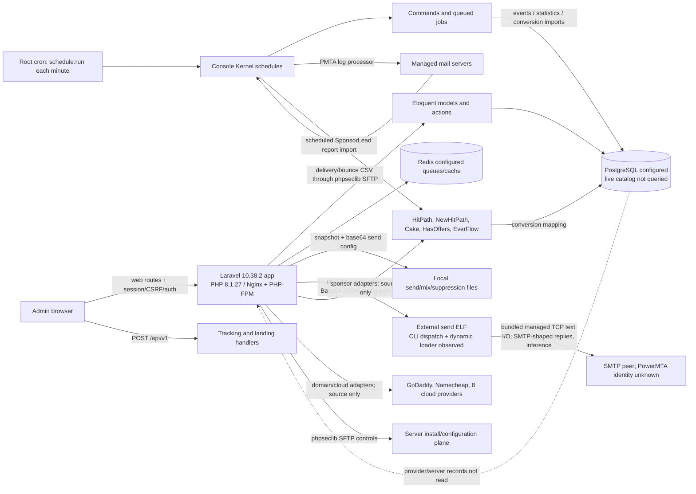

# DMS Reference System — Evidence-Bounded Architecture

**Status: Backend source paths are mapped. Live data, effective runtime settings, managed mail-server configuration, and sender internals remain partially verified.** The bundled managed sender has a reachable TCP text path and SMTP-shaped reply parser; SMTP compatibility is an inference. This diagram shows static source relationships, not observed production traffic or live queue contents.

## Evidence and confidence

- **OBSERVED:** Nginx/PHP-FPM Laravel deployment, framework/dependency versions, route and middleware groups, queue/Horizon configuration, source-level campaign/recipient/tracking/integration paths, scheduled jobs, and selected active service names. Evidence paths are indexed in [PROGRESS.md](PROGRESS.md) and the topic reports.
- **DERIVED:** The campaign snapshot/config → external send process path and the PMTA file → statistics/recipient-state processing path follow direct static call chains. Sponsor conversions are fetched by scheduled adapters and mapped to visitor lead records.
- **INFERRED:** Redis is the active queue backend because it is the configured default; a process-level override and active Horizon environment were not checked. The ELF's `dlopen`/`dlsym` path is apphost bootstrap behavior; managed CIL separately establishes a reachable TCP text path with SMTP-shaped response parsing.
- **UNKNOWN/BLOCKED:** deployed PostgreSQL catalog/version/grants, live queue payloads and worker state, provider credentials/resources, active PMTA versions/config, DNS/mail topology, complaint feedback source, and sender message construction, literal commands, peer identity, retry, and reconciliation behavior. The apphost itself has no recovered direct transport call; the managed assembly does.

## Component boundaries

The source describes one Laravel application with Eloquent models, PostgreSQL configuration, Redis-configured queue/cache, file-backed audience/send artifacts, and external network control planes. Separate runtime microservices or tenancy/data-isolation boundaries were not established. Source inventory and front-end module taxonomy are detailed in [BACKEND_ARCHITECTURE.md](BACKEND_ARCHITECTURE.md), [DATABASE_ARCHITECTURE.md](DATABASE_ARCHITECTURE.md), [CAMPAIGN_ORCHESTRATION.md](CAMPAIGN_ORCHESTRATION.md), [TRACKING_AND_ANALYTICS.md](TRACKING_AND_ANALYTICS.md), [MAIL_INFRASTRUCTURE.md](MAIL_INFRASTRUCTURE.md), and [EXTERNAL_INTEGRATIONS.md](EXTERNAL_INTEGRATIONS.md).

No database rows, provider data, application settings values, customer data, production logs, message bodies, or secrets appear in this architecture map. No AlphaLink stack is selected.
